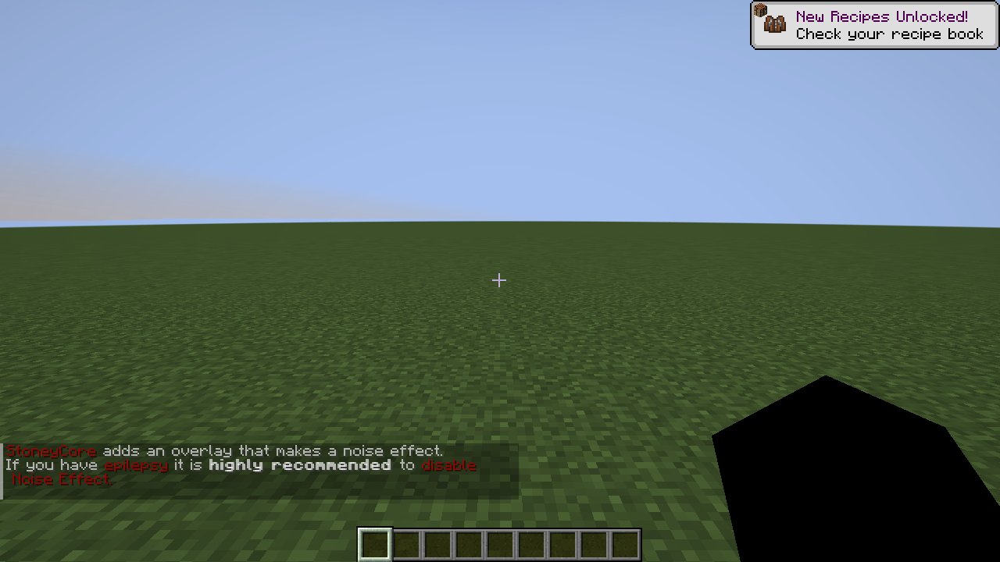
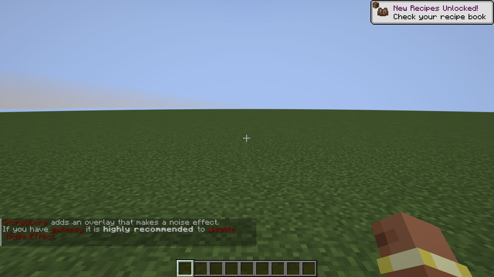

# Punchy x Knights & Heraldry

A small client-side compatibility mod for **NeoForge 1.21.1** between [Punchy!](https://modrinth.com/mod/punchy-fpa) and
[Knights & Heraldry](https://modrinth.com/mod/knights-and-heraldry) (with its library StoneyCore).

**The problem.** Punchy! draws the first-person arms itself, and draws the worn armour on them the vanilla way: from the chest
armour's vanilla armour-layer texture. Knights & Heraldry's body armour is StoneyCore's *under-armour* (a gambeson, a doublet...)
with plates, mail and gauntlets put on it as attachments; it has no vanilla armour-layer texture, so Punchy's arm came out black
and purple (the missing texture).

**The fix**, through Punchy's own public API (`PunchyApi.hideLayers` and `PunchyApi.drawOnArm`): while StoneyCore under-armour is
worn on the chest, Punchy's armour layer is left out, and what StoneyCore draws on Minecraft's own first-person arm is drawn on
Punchy's arm instead, in the pose Punchy gives it: the under-armour sleeve with its texture (dyed when it is dyeable, with its
overlay), then each attachment's own first-person drawing. When Punchy hands the arm back to Minecraft, StoneyCore draws it
itself as before.

| Before (Punchy alone) | With this mod | Holding a sword |
|---|---|---|
|  |  |  |

## Requirements

| | Version |
|---|---|
| Minecraft | 1.21.1 |
| NeoForge | 21.1.253 or newer |
| Punchy! | 3.0 or newer (NeoForge) |
| StoneyCore | 1.2.0 or newer (Knights & Heraldry 1.2.0) |

Install on the client (a server does not need it).

## Building

```bash
./gradlew build
```

`./gradlew runShots` (dev only) starts a client with all the mods, dresses the player in a gambeson with a plate cuirass and
gauntlets and saves first-person screenshots to `shots/`; it runs headless under `xvfb-run` too.

## License

MIT. Punchy! and Knights & Heraldry are their authors'; this mod uses Punchy's public API and calls StoneyCore's own
renderers.
