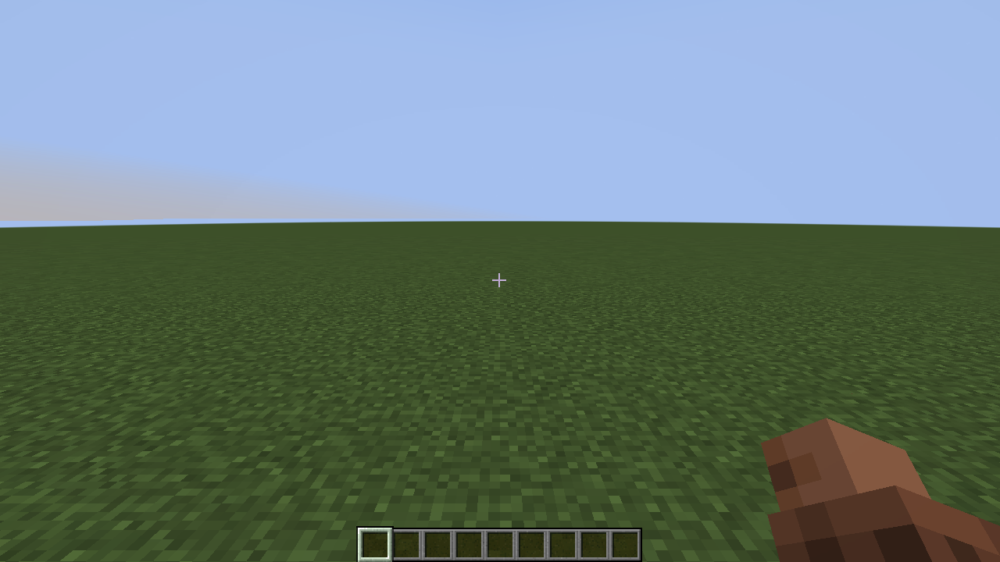
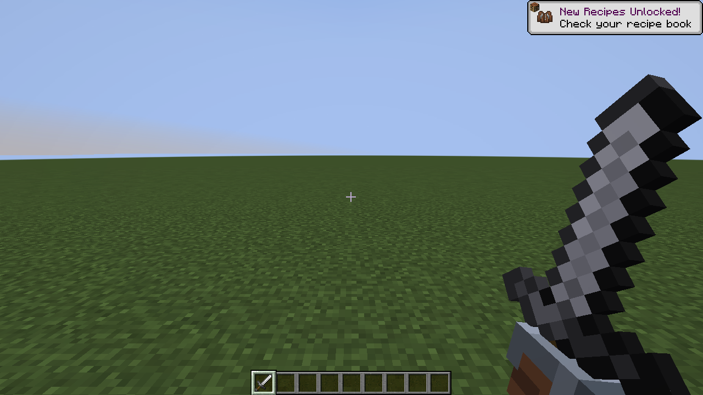

# Punchy x Knights & Heraldry

A small client-side compatibility mod for **NeoForge 1.21.1** between [Punchy!](https://modrinth.com/mod/punchy-fpa) and
[Knights & Heraldry](https://modrinth.com/mod/knights-and-heraldry) (with its library StoneyCore).

**The problem.** Punchy! draws the first-person arms itself, and draws the worn armour on them the vanilla way: from the chest
armour's vanilla armour-layer texture. Knights & Heraldry's body armour is StoneyCore's *under-armour* (a gambeson, a doublet...)
with plates, mail and gauntlets put on it as attachments; it has no vanilla armour-layer texture, so Punchy's arm came out black
and purple (the missing texture).

**The fix.** Punchy draws the chest armour's arm from the armour's model and its armour-layer textures. For StoneyCore's
under-armour this mod hands it the model and texture StoneyCore dresses the body in, and draws the sleeve itself where Punchy
draws armour: StoneyCore keeps its real sleeves in separate parts (`armorRightArm` / `armorLeftArm`) mapped on its own
128-pixel texture, and its armour materials have no vanilla layers for Punchy to draw. The sleeve is dyed as the under-armour
is, with its overlay; then every attachment put on it (plate arms, gauntlets...) is drawn with Knights & Heraldry's own
first-person renderer, posed as Punchy's arm.

| Before (Punchy alone, gambeson with plates) | Gambeson | Gambeson with plate cuirass and gauntlets | Holding a sword |
|---|---|---|---|
|  |  |  |  |

For comparison, the bare arm (the dev skin) is in `docs/bare.png`.

## Requirements

| | Version |
|---|---|
| Minecraft | 1.21.1 |
| NeoForge | 21.1.253 or newer |
| Punchy! | 3.0 or newer (NeoForge) |
| StoneyCore | 1.2.0 or newer (Knights & Heraldry 1.2.0) |

Install on the client (a server does not need it).

## Building

```bash
./gradlew build
```

`./gradlew runShots` (dev only) starts a client with all the mods, dresses the player in a gambeson with a plate cuirass and
gauntlets and saves first-person screenshots to `shots/`; it runs headless under `xvfb-run` too.

## License

MIT. Punchy! and Knights & Heraldry are their authors'; this mod uses Punchy's public API and calls StoneyCore's own
renderers.
